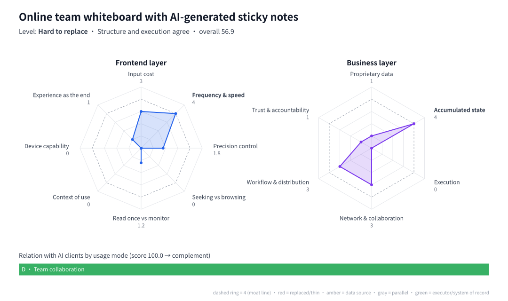
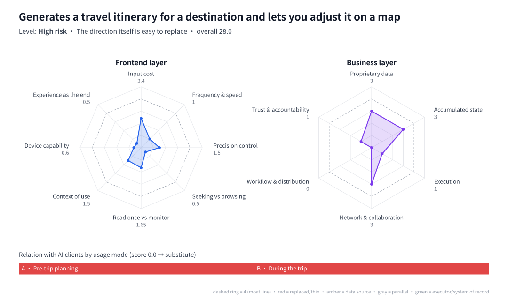

# AI Replaceability Check

English | [中文](README.zh-CN.md)

A Claude skill that answers one question about a product idea:

> **Does a user have a reason not to just open ChatGPT / Claude / Gemini / Doubao instead?**

It breaks a product into usage modes, judges how each mode relates to general AI clients, scores 8 frontend aspects and 6 business moats with a calibrated script, and returns a verdict with a radar chart and the three moats that are closest to reach.



## Why I built this

*2026-11-19*

I was building a small frontend product. The longer I worked on it, the less I could answer one question: no matter how much I polished it, why wouldn't people just ask an AI client? In the end I talked myself out of the product.

I noticed that this keeps happening to ideas, mine and other people's. Either you kill an idea on a hunch, or you build it and learn the hard way. I wanted something in between: a standard that takes a product apart and shows *where* it is exposed and *where* it could hold ground.

My starting intuition was that the structure "you type a need, it gives you advice" is the easiest kind for an AI client to swallow. A travel-itinerary app is the textbook case. I turned that intuition into a framework with service types, frontend aspects and business moats. Then I tested it against real products, including two rounds of blind predictions that were locked before the outcomes were checked. I kept whatever survived.

I designed and tested it together with Claude in one long conversation. This repo is the record of that idea.

## How it works

```
describe a product ──► 1. decompose ──► 2. review ──► 3. score (script) ──► 4. compare ──► 5. report
                        usage modes,     adversarial     no hand math        41 real
                        types, levels    check of the                        products
                                         card
```

**Three layers and a relation:**

| Layer | What it asks | Examples |
|---|---|---|
| **Service type** (9) | How replaceable is this kind of service by structure? | *Generate / advise* is the most exposed; *own transactions* and *social communities* are the least |
| **Frontend** (8 aspects) | Does the interface do something a chat box can't? | Input cost, frequency, precision control, seeking vs browsing, monitoring, context of use, device, experience-as-the-end |
| **Business** (6 dimensions) | What does the product own? | Proprietary data, accumulated state, execution, network, workflow, trust |
| **Relation with AI clients**, per usage mode | Does AI replace it, call it, run parallel to it, or need it? | Replaced directly / callable but thin / data source / parallel / complementary |

**The verdict comes from moats, not averages.** Any of the 14 items scoring 4 or more counts as a moat. With no moats the level is *High risk*, with one it is *One moat*, and with two or more it is *Hard to replace*. A substitute relation with AI clients drops it one level. A product that both depends on search traffic and is substituted by AI drops one more. Eight items at 3 still lose to one item at 5.

The full rules are in [`scoring.md`](ai-replaceability-check/references/scoring.md).

## How accurate is it?

| Test | Result |
|---|---|
| Round 2, blind, 14 products | 10/14 compatible with real outcomes |
| Round 3, blind, 13 products | 10/13 compatible |
| All 41 products, current rules (in-sample) | 40/41 |

**The honest number is about 3 in 4, out of sample.** The 40/41 is in-sample, because the current rules were built from those misses. Most remaining errors come from decomposition, especially judging the relation with AI clients, not from the formula. That is why the skill has a separate review step.

Everything is reproducible:

```bash
python3 calibration/run_calibration.py
```

This re-scores all 41 cards, prints the per-round results, and recomputes the SHA-256 fingerprints of the locked blind predictions. See [`calibration/README.md`](calibration/README.md) for the method, outcome labels and limitations.

## Install

The skill is the [`ai-replaceability-check/`](ai-replaceability-check) folder. The scorer uses only the Python standard library.

**Claude Code**

```bash
# for all your projects
cp -r ai-replaceability-check ~/.claude/skills/
# or for one project
cp -r ai-replaceability-check your-project/.claude/skills/
```

**Claude app (web / desktop)**

```bash
zip -r ai-replaceability-check.zip ai-replaceability-check/
```

Upload the ZIP under **Customize → Skills**. Code execution must be enabled in settings, because the skill runs its scoring script. See [Use skills in Claude](https://support.claude.com/en/articles/12512180).

## Usage

Just describe the idea. The skill triggers on questions like these:

- "I want to build an app that plans trips from a destination and dates. Will AI clients kill it?"
- "Is this just a ChatGPT wrapper? Where's the moat?"
- "Compare these three side-project ideas for AI replaceability."
- "这个产品会不会被 AI 取代？护城河在哪？"

You get a report in your language. It covers the core loop, the type, a per-mode relation table, both layers with evidence, how the verdict was reached, a radar chart, the closest real-world cases, the strongest case for "just use an AI client", and concrete actions for the three nearest moats.

Full example: [`examples/travel-itinerary-report.md`](examples/travel-itinerary-report.md)



You can also run the scorer on a card directly:

```bash
python3 ai-replaceability-check/scripts/score.py examples/travel-itinerary.json --svg chart.svg
python3 ai-replaceability-check/scripts/score.py examples/*.json        # rank several
python3 ai-replaceability-check/scripts/score.py card.json --json       # machine-readable
```

## Self-check

I ran the skill on itself as if it were a standalone product ([`examples/self-check.json`](examples/self-check.json)). Result: **High risk**, overall 7.7. A set of instructions plus a small script is exactly what an AI client can run, so it has no reason to exist as a paid product. That's why it is an open-source skill.

## Limitations

- **It measures structure, not demand.** It asks whether users have a reason to bypass you for an AI client. It does not ask whether anyone wants the product; only real users answer that.
- **41 products** is a small sample. Most are well-known companies, because they have public data.
- **Prior knowledge.** The calibration cards were written by a model that knew about these companies up to mid-2026. Locking guarantees that cards weren't changed after outcomes were checked, not that the model was naive.
- **Resilient vs benefiting is untested.** Only 3 products are in the "benefiting" group. Canva, the one remaining in-sample miss, is exactly that case.
- **Context of use and device capability are barely tested.** Only Strava and Oura exercise them.
- **It assumes AI clients keep getting stronger.** They can already browse, read files, remember, render cards and maps, call apps, and run skills. If your moat is on that list, it isn't one.

## Related work

- [Moatix](https://www.indiehackers.com/product/moatix): a paid 24-question diagnostic that scores how defensible a SaaS business is against AI.
- [Preuve AI](https://preuve.ai/blog/are-ai-wrapper-startups-worth-building-2026): idea validation against live market data. Its rule of thumb is that an AI wrapper is worth building only if it owns a moat the model provider can't ship next quarter, such as proprietary data, workflow lock-in or distribution.
- General idea validators (ValidatorAI and similar) ask whether there is a market.

This skill is narrower. It asks only about replacement by general AI clients. It adds a frontend layer and a per-usage-mode relation. It publishes its calibration, misses included.

## Repository layout

```
ai-replaceability-check/          the skill (copy this folder)
├── SKILL.md                      workflow
├── references/
│   ├── decompose.md              decomposition prompt: modes, types, levels, relation
│   ├── review.md                 12-point adversarial review, each tied to a real miss
│   ├── scoring.md                every rule, with worked examples
│   ├── calibration.md            41 real products with outcomes and lessons
│   └── report.md                 report template
└── scripts/
    ├── score.py                  scorer and SVG radar chart (stdlib only)
    └── config.json               all weights and thresholds
examples/                         three cards, charts, and a full report
calibration/                      cards, outcomes, locked predictions, reproduction script
└── original-reports-zh/          the original round reports (Chinese)
```

## Contributing

The most useful contribution is **a product whose real outcome disagrees with the verdict**. Open an issue with the card (or just the product name) and what actually happened. Misses are how the rules got this far.
