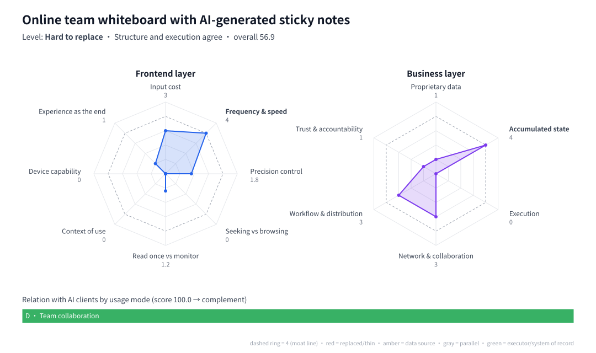

# AI 可替代性评估

[English](README.md) | 中文

一个 Claude skill，只回答一个问题：

> **用户有没有理由不直接打开 ChatGPT / Claude / Gemini / 豆包，而是用你的产品？**

它会把产品拆成若干使用模式，逐个判断每个模式与通用 AI 客户端的关系，再用经过校准的脚本给 8 个前端方面和 6 个业务护城河打分。最后输出结论、雷达图，以及离你最近的三条护城河。

> skill 本体（SKILL.md 和 references）用英文写成，方便模型阅读；报告会按用户的语言输出。

## 为什么做这个

*2026-11-19*

我原本在做一个偏前端的小产品。做着做着，有个问题我越来越答不上来：不管怎么优化，用户凭什么不直接去问 AI 客户端？最后，这个产品被我自己否掉了。

我发现想法常常是这样死掉的：要么凭直觉在脑子里被扼杀，要么做出来之后才吃亏。我想要一个介于两者之间的东西，一套能把产品拆开来看的标准，看清它**哪里**会被替代、**哪里**还有机会守住。

我最初的直觉是：「输入需求、给出建议」这种结构最容易被 AI 客户端吞掉，旅游攻略就是最典型的例子。后来我把这个直觉做成了一套框架，包括服务类型、前端方面和业务护城河。我又用真实产品去检验它，其中有两轮盲测，预测在查看结果之前就已锁定。能经得住检验的规则，才被留了下来。

这套框架是我和 Claude 在一次长对话里一起设计、一起测试的。这个仓库就是这个想法的见证。

## 工作方式

1. **拆解**：拆出使用模式，用移除测试确定服务类型，判断前端小类和业务等级，再逐个模式判断与 AI 客户端的关系。
2. **复核**：用 12 条检查项做对抗式复核，每一条都对应一次真实的误判。
3. **打分**：由脚本计算，不手算。
4. **对照**：从 41 个真实产品里找相似案例做参照。
5. **报告**：按用户的语言输出。

**结论看护城河，不看平均分。** 14 个项目中，得分 ≥4 的项目算一条护城河：

- 0 条为高风险（High risk），1 条为单一护城河（One moat），2 条及以上为难以替代（Hard to replace）。
- 如果与 AI 客户端是替代关系，结论降一级。
- 如果同时依赖搜索流量，再降一级。

## 准确率

| 测试 | 结果 |
|---|---|
| 第二轮盲测，14 个产品 | 10/14 与真实结果相符 |
| 第三轮盲测，13 个产品 | 10/13 相符 |
| 全部 41 个产品，当前规则（样本内） | 40/41 |

**诚实的数字是样本外约 3/4。** 40/41 属于样本内结果，因为当前规则正是从那些误判中修订出来的。复现方式：`python3 calibration/run_calibration.py`。三轮的中文原始报告保存在 [`calibration/original-reports-zh/`](calibration/original-reports-zh)。

## 安装

**Claude Code**：`cp -r ai-replaceability-check ~/.claude/skills/`

**Claude 网页版 / 桌面版**：先执行 `zip -r ai-replaceability-check.zip ai-replaceability-check/`，然后在 **Customize → Skills** 中上传这个 ZIP 文件。需要在设置里开启代码执行。

## 使用

直接描述你的想法即可，例如：「我想做一个根据目的地和日期生成行程的 App，会被 AI 取代吗？」「这是不是套壳？护城河在哪？」

完整示例报告见 [`examples/travel-itinerary-report.md`](examples/travel-itinerary-report.md)（英文）。

## 自检

我把这个 skill 本身当作一个独立产品来评估，结果是**高风险**（7.7 分）。一套指令加一个小脚本，正是 AI 客户端自己就能运行的东西，所以它不适合做成收费产品，只适合开源成一个 skill。

## 局限

- 它衡量的是结构，不是需求。有没有人需要这个产品，只有真实用户能回答。
- 样本只有 41 个，而且大多是知名公司。
- 「稳健」和「受益」之间的区分几乎没有经过检验。
- 它默认 AI 客户端会越来越强。

## 参与贡献

最有价值的贡献是：**一个真实结果与结论不符的产品**。欢迎提 issue，附上产品名称和实际发生的情况。
