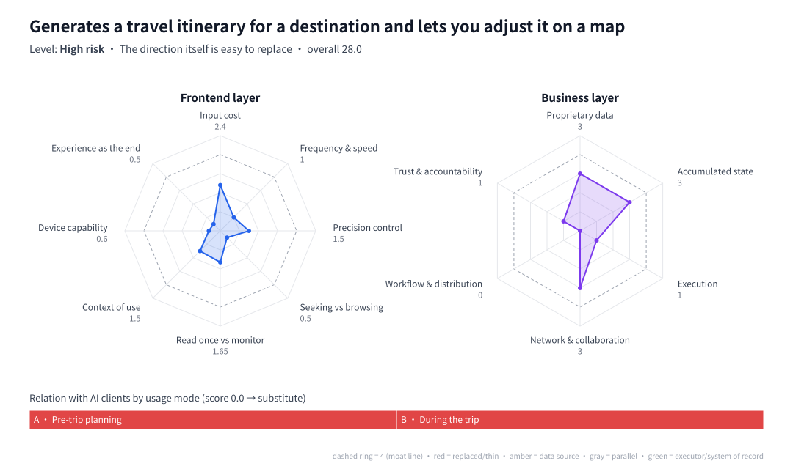

# Travel itinerary generator: AI replaceability check

*Example output. Card: `travel-itinerary.json`. Chart: `travel-itinerary.svg`.*

**Level: High risk**: the direction itself is easy to replace.
The core output, an itinerary, is exactly what AI clients already produce for free, and the money changes hands on someone else's platform.

## Core loop

Input: destination, dates, party size → The product: generates an itinerary and shows hotels with live prices → Output: an itinerary that can be adjusted on a map → The user then: books hotels on a third-party platform

Value is realized: mixed. Itinerary management happens in the product; booking happens elsewhere.

## Type

Primary: Generate / advise | Secondary: Tool / editor (map editing, 45% of activity) | Structural potential: 1.6

## Relation with AI clients, by usage mode

| Usage mode | Share | Relation | Why |
|---|---|---|---|
| Pre-trip planning | 50% | A, replaced directly | AI clients generate itineraries and can call booking platforms for live prices |
| During the trip | 50% | B, callable but thin | AI clients can also keep, show, and adjust an itinerary |

Relation score: 0 → substitute

## Frontend layer

| Aspect | Score | Evidence |
|---|---|---|
| Input cost | 2.40 | Drag-to-edit on the map is direct manipulation, but entering the trip is one sentence |
| Frequency & speed | 1.00 | A few trips a year; intense only during the trip |
| Precision control | 1.50 | Changing one day without disturbing others |
| Seeking vs browsing | 0.50 | Users come with a goal |
| Read once vs monitor | 1.65 | Lock-screen itinerary card during the trip |
| Context of use | 1.50 | Glancing at the map while walking |
| Device capability | 0.60 | Reminders and a lock-screen card only |
| Experience as the end | 0.50 | Planning is a means to travel |

## Business layer

| Dimension | Level | Evidence |
|---|---|---|
| Proprietary data | L3 | Live prices via a partner API [assumed] |
| Accumulated state | L3 | Itineraries users keep maintaining [inferred] |
| Execution | L1 | Booking links out [assumed] |
| Network & collaboration | L3 | Companions vote on changes [stated] |
| Workflow & distribution | L0 | Standalone app |
| Trust & accountability | L1 | Users can fix mistakes themselves |

## How the verdict was reached

- 0 moat items → High risk
- The relation score of 0 is below 35 (substitute), but the level cannot go lower

Closest calibration cases: **Tome** (generate + tool, collapsed: rare use, no state, no workflow) and, by contrast, **Booking.com** (resilient because the booking and payment stay with it, which this product links away from).

## Strongest case for "just use an AI client"

Ask any AI client to "plan four days in Chengdu for two, mid-range hotels". You get an itinerary in seconds, live prices through the booking apps inside the chat, and changes by simply saying "swap day 2 and day 3". The map drag is nicer, but not something a traveler would install an app for a few times a year.

## Where to build a moat

- **Accumulated state (now L3)**
  - Make the itinerary the trip's single living document: bookings imported automatically from confirmation emails, shared expenses split among companions, photos and notes attached day by day.
  - Keep every past trip as a reusable travel history.
  - Likely result: L4. Moving out would mean rebuilding the trip by hand.
- **Proprietary data (now L3)**
  - Collect what completed trips reveal: how long people actually stayed at each sight, what was closed or crowded, and which routes really worked.
  - Feed this back into generation.
  - Likely result: L4. Data that comes from use and improves the product.
- **Input cost (now 2.4)**
  - Make direct manipulation the core of every step rather than one step: build the trip by dragging sights onto days, and adjust times with sliders.
  - Likely result: about 4. Note that this **turns the product into a tool-type map planner** (potential 3), a pivot rather than an improvement. If you go that way, run the check again on the new version.

## Risks

- Value is realized on the booking platform, not in the product. Booking platforms are already inside AI clients.

## Key assumptions to verify

- Hotel prices and availability come from a third-party platform API
- Bookings are completed on the third-party platform

## If you decide not to build it

Its core output is the one thing AI clients already do well, and the transaction it leads to belongs to someone else.

---
This is a structural analysis, not a market forecast. It asks whether users have a reason not to just use an AI client. It does not ask whether anyone needs the product; only talking to real users answers that. In blind tests on real products, about three in four verdicts matched what actually happened.
